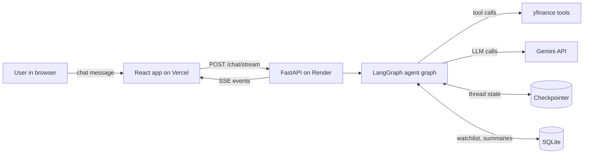
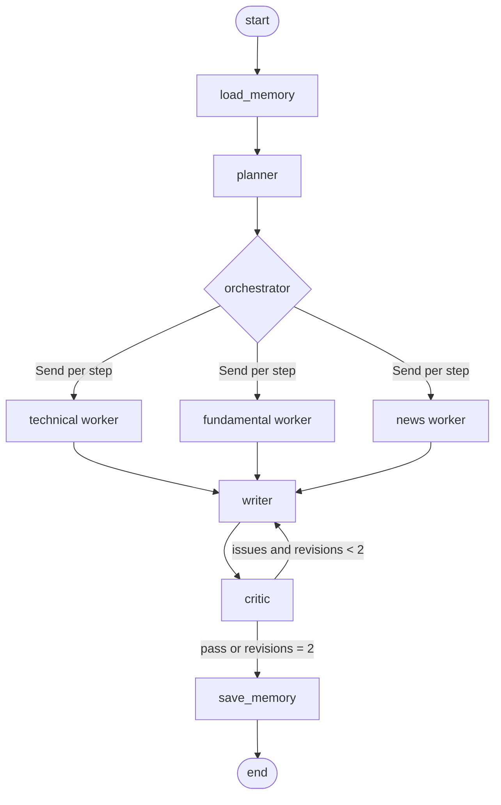

# Architecture

## 1. System view



One request, one streamed response. The browser never talks to Gemini or yfinance directly, so the API key stays on the server.

## 2. The agent graph



| Node | Pattern | What it does |
|---|---|---|
| `load_memory` | Memory | Reads the user's profile and the latest past summaries, trims the message window |
| `planner` | Plan and execute | Calls the LLM with a structured-output schema and returns 1 to 6 steps |
| `orchestrator` | Orchestrator/worker | A conditional edge that returns one `Send` per step to the right worker; workers append to `state.findings` through a list reducer and the writer runs once after all of them |
| `technical`, `fundamental`, `news` | Tool use | Small tool-calling agents, each with its own prompt and only the tools it needs |
| `writer` | Synthesis | Writes the report in a fixed Markdown format from the findings only |
| `critic` | Reflection | Rule checks (every number must appear in the tool evidence, no trade instructions, a Risks section) plus one LLM review; returns `pass` or `revise` with issues |
| `save_memory` | Memory | Stores a one-line summary and any watchlist changes |

## 3. State

```python
class AgentState(TypedDict):
    messages: Annotated[list, add_messages]   # conversation, trimmed on load
    user_id: str
    profile: dict                              # risk_profile, watchlist, recent_summaries
    plan: list[Step]                           # from the planner
    findings: Annotated[list[Finding], add]    # appended by workers in parallel
    draft: str
    critique: Critique | None
    revisions: int
    final: str
```

```python
class Step(BaseModel):
    id: int
    worker: Literal["technical", "fundamental", "news"]
    ticker: str
    goal: str                       # e.g. "Is the RSI overbought and is price above the 200-day average?"

class Finding(BaseModel):
    step_id: int
    worker: str
    ticker: str
    evidence: dict                  # raw numbers and headlines returned by tools
    notes: str                      # the worker's short reading of the evidence

class Critique(BaseModel):
    verdict: Literal["pass", "revise"]
    issues: list[str]               # each issue names the claim and what evidence is missing
```

## 4. Tools (pattern 1)

| Tool | Returns | Source |
|---|---|---|
| `get_price_snapshot(ticker)` | last price, 1-month and 6-month change, 52-week range | yfinance history |
| `get_technicals(ticker)` | RSI(14), MACD and signal, SMA50, SMA200, price vs each | computed with pandas |
| `get_fundamentals(ticker)` | trailing and forward P/E, margins, revenue growth, debt to equity | yfinance info |
| `get_news(ticker, n=5)` | up to five recent headlines with publisher and date | yfinance news |

Rules: tools return plain dicts, never raise to the model (they return `{"error": "..."}`), and cache results in memory for 10 minutes so a follow-up question does not call yfinance again.

## 5. Workers (pattern 3)

| Worker | Tools | Prompt in one line |
|---|---|---|
| Technical | `get_price_snapshot`, `get_technicals` | Read the numbers, do not predict prices |
| Fundamental | `get_fundamentals`, `get_price_snapshot` | Judge valuation and quality against the numbers returned |
| News | `get_news` | Summarize what changed and flag anything material, citing the headline |

Each worker is a small ReAct-style agent built with the prebuilt helper in the installed LangGraph version, capped at 3 tool calls.

## 6. Reflection loop (pattern 4)

The critic receives the draft and `findings` only, and answers three questions:

1. Is every number in the draft present in the findings?
2. Does any sentence promise a result or give a trade instruction?
3. Are the sections for risks and the disclaimer present?

If any answer is bad it returns `revise` with specific issues, and the writer rewrites with those issues attached. The loop stops after two revisions. The final event reports how many revisions it took, which is also the number we measure.

## 7. Memory and context (pattern 5)

| Layer | Mechanism | Lifetime | Used for |
|---|---|---|---|
| Thread memory | LangGraph checkpointer keyed by `thread_id` | the conversation | follow-ups such as "and what about its valuation?" |
| Long-term store | SQLite: `profile`, `analysis_log` | across sessions (resets on Render redeploy) | watchlist, risk profile, last five summaries |
| Context window | keep the last 6 messages, inject up to 5 summaries of at most 300 characters | per call | stays inside the model's limits and the free-tier token budget |

User identity is an anonymous UUID created in the browser and stored in `localStorage`. There is no login.

SQLite schema:

```sql
CREATE TABLE profile (
  user_id TEXT PRIMARY KEY,
  risk_profile TEXT DEFAULT 'balanced',   -- conservative | balanced | aggressive
  watchlist TEXT DEFAULT '[]',            -- JSON list of tickers
  updated_at TEXT
);
CREATE TABLE analysis_log (
  id INTEGER PRIMARY KEY AUTOINCREMENT,
  user_id TEXT, tickers TEXT, question TEXT, summary TEXT, created_at TEXT
);
```

No extra LLM call is used for memory. The writer ends with a one-line TL;DR, which is stored as the summary. The risk profile comes from a selector in the UI.

## 8. Streaming

The graph is run with LangGraph's streaming API and workers emit custom events through the stream writer. The API converts them into the SSE events in `API_SPEC.md`: `plan`, `worker_start`, `tool_call`, `worker_done`, `draft`, `critique`, `final`, `error`. The frontend renders them in the trace panel as they arrive.

## 9. Backend layout

```
backend/app/
├── main.py            FastAPI app, CORS, routes
├── config.py          env vars, model names, limits
├── graph/
│   ├── state.py       AgentState and the pydantic models above
│   ├── nodes.py       planner, workers, writer, critic, memory nodes
│   ├── build.py       assembles and compiles the graph
│   └── prompts.py     prompt strings in one place
├── tools/
│   ├── market.py      the four tools
│   └── cache.py       10-minute TTL cache
├── memory/
│   └── store.py       SQLite helpers
├── api/
│   ├── stream.py      graph events to SSE
│   └── limits.py      per-IP request limiter
└── tests/             unit tests with a fake LLM and fixture data
```

## 10. Frontend layout

```
frontend/src/
├── App.tsx            two-column layout
├── lib/api.ts         fetch + SSE reader, user id helper
├── components/
│   ├── Chat.tsx       messages and input
│   ├── TracePanel.tsx plan checklist, worker cards, critic verdict
│   ├── MemoryPanel.tsx watchlist and risk profile selector
│   └── Disclaimer.tsx
└── main.tsx
```

Wireframe:

```
┌───────────────────────────────┬───────────────────────────────┐
│ AlphaDesk            [risk ▾] │ Agent trace                   │
│                               │ Plan                          │
│ You: Compare AAPL and MSFT    │  ☑ 1 technical AAPL           │
│ Agent: ...report (markdown)   │  ☑ 2 fundamental AAPL         │
│                               │  ◐ 3 news MSFT                │
│                               │ Tool calls  get_news(MSFT)    │
│ [ Ask about a stock...  ] [↑] │ Critic: revise → pass (1 rev) │
│                               │ Memory: saved summary, +AAPL  │
└───────────────────────────────┴───────────────────────────────┘
  Not financial advice.
```

## 11. Limits that keep it free and calm

| Limit | Value | Why |
|---|---|---|
| Steps per plan | 6 | bounds Gemini calls per request |
| Tool calls per worker | 3 | prevents loops |
| Revisions | 2 | bounds the reflection loop |
| Concurrent workers | 2 | stays under free-tier requests per minute |
| Requests per IP | 6 per hour | protects the shared free API key |
| Typical LLM calls per answer | 6 to 10 | planner, workers, writer, critic, plus revisions |

## 12. LLM layer (`graph/llm.py`)

```
call(prompt, schema=None)
  for model in OPENROUTER_MODELS:          # free models, in order
      try: return invoke(model)            # 1 retry on 429 with short backoff
      except (RateLimit, Timeout, BadStructure, Empty): continue
  return invoke(GEMINI_3_8_FLASH)          # last resort, own key
```

- Structured steps (planner, critic) prefer models that advertise structured output; if one returns invalid JSON it counts as a failure and the next model is tried.
- The model that actually answered each call is logged and included in the `final` event, together with how many models were skipped.
- Free models are shared and can disappear, so the demo-set measurements must record which model answered.
